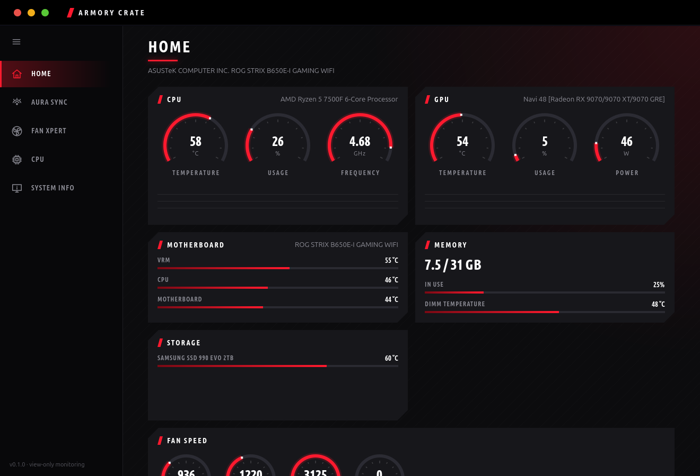
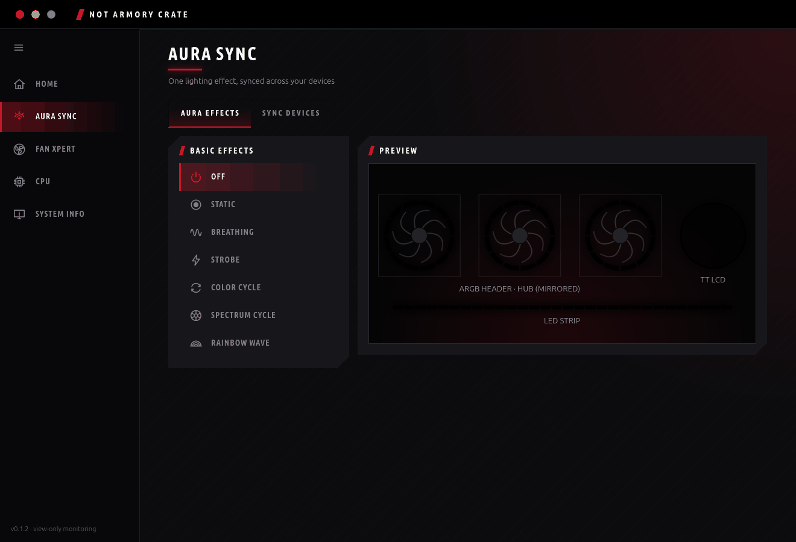
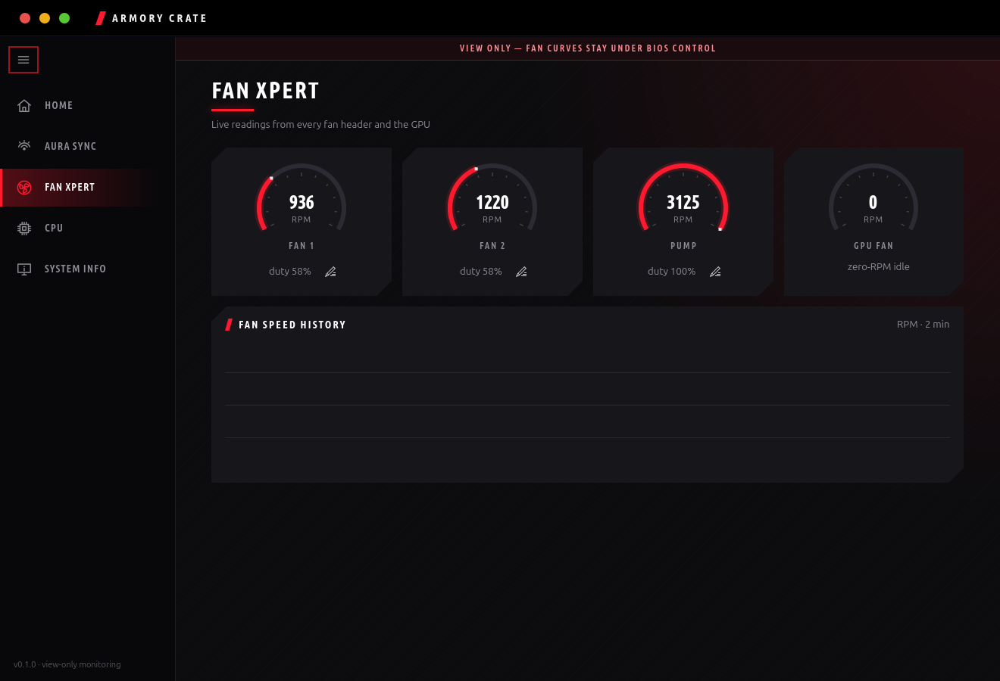

<div align="center">

# Armory Crate for Linux

**A Linux equivalent of ASUS Armoury Crate: live sensors and Aura Sync RGB lighting, read-only except for lighting.**

Python, GTK4 and libadwaita. No Windows, no Armoury Crate service, no telemetry.

[](https://github.com/anatolijphp/armory-crate-alternative-ubuntu/actions/workflows/build.yml)
[](https://github.com/anatolijphp/armory-crate-alternative-ubuntu/releases)




</div>

## Highlights

|  |  |
|---|---|
| 📊 **Home dashboard** | Live tiles: CPU, GPU, motherboard, memory, storage, fans - the same at-a-glance layout as Armoury Crate's own home page |
| 🌈 **Aura Sync** | One lighting effect synced across every supported RGB device, rendered in software and streamed over USB HID |
| 🖥️ **CPU / Fan Xpert / System Info** | Per-thread clocks, amd-pstate status, fan RPM and duty with history, full board/BIOS/GPU/RAM/storage inventory - all **view only**, nothing here changes clocks, boost, power policy or fan curves |
| 🧩 **Tray icon** | A real StatusNotifierItem in the Ubuntu panel (no GTK3/GTK4 conflict - talks the protocol directly), with the Aura Sync effect picker right in its menu |
| 📐 **Responsive layout** | Every page's panel grid reflows with the window width instead of squeezing a fixed column count |
| 🔒 **Hardware safety first** | Opcode allow-lists, strict device matching, no firmware/flash commands anywhere - see [Firmware safety rules](#firmware-safety-rules) |

## Screens

### Aura Sync

Pick an effect and it's synced across every supported device at once - the mainboard's onboard LEDs, RGB and ARGB headers, and any virtual device feeding another app's screen (for example [ttlcd](https://github.com/anatolijphp/Thermaltake-TH240-V2-ULTRA-LCD)'s cooler LCD).



### Fan Xpert

Every fan header's RPM and duty cycle, plus the GPU fan, with a running history graph. Headers read from the Super-I/O chip can be renamed to match what they're actually plugged into.



## Install

Download **`armory-crate_<version>_all.deb`** from the [latest release](https://github.com/anatolijphp/armory-crate-alternative-ubuntu/releases)
(or the newest run on the [Actions](https://github.com/anatolijphp/armory-crate-alternative-ubuntu/actions) tab) and install it:

```sh
sudo apt install ./armory-crate_*_all.deb    # pulls in GTK4, libadwaita and their Python bindings
armory-crate probe                           # read-only: firmware string + config table
# review the output, then:
systemctl --user enable --now armory-crated
```

The package adds a udev rule that gives your login session access to **only** one hidraw interface
(the Aura controller `0b05:19af`, interface 2), and loads `nct6775` now and on every boot for fan
RPMs. Not on Debian/Ubuntu? Unpack `armory-crate-<version>-linux.tar.gz` from the same release to `/`
instead (`sudo tar -xzf ... -C /`), then install GTK4 + libadwaita + their Python bindings yourself.

To remove it: `sudo apt remove armory-crate`.

### Running from a checkout

No build step needed to just run it - `./packaging/install.sh` installs straight from the repo
(asks for your sudo password, same udev/nct6775/service setup as the `.deb`, but installs the
launcher, desktop entry and service under `~/.local` instead of system-wide). Remove it with
`./packaging/uninstall.sh`.

## Build from source

```sh
git clone https://github.com/anatolijphp/armory-crate-alternative-ubuntu.git
cd armory-crate-alternative-ubuntu
./build.sh
```

| Path | What |
|---|---|
| [`armory_crate/ui/`](armory_crate/ui) | GTK4/libadwaita window, pages, tray icon, off-screen capture |
| [`armory_crate/aura/`](armory_crate/aura) | Device registry, USB HID protocol, software effects, sync engine |
| [`armory_crate/sensors/`](armory_crate/sensors) | CPU, GPU, board and system readings (all read-only) |
| [`armory_crate/daemon/`](armory_crate/daemon) | `armory-crated`: the background Aura Sync service, exposed over D-Bus |
| [`packaging/`](packaging) | Checkout installer/uninstaller, udev rule, systemd unit, desktop entry, icon, `.deb` templates |
| [`docs/`](docs) | Protocol/virtual-device notes and README media |
| [`tests/`](tests) | Firmware safety rules and effect/driver unit tests |

`build.sh` lays `armory_crate` out at `/usr/lib/python3/dist-packages` (the same place Debian/Ubuntu's own `python3-*`
packages live) and builds `build/linux/armory-crate_<version>_all.deb`, plus an `armory-crate-<version>-linux.tar.gz`
for other distributions - plain `dpkg-deb --build`, no debhelper, the same approach as ttlcd's own `build.sh`.

Every push runs [GitHub Actions](.github/workflows/build.yml): unit tests, a compile check of every module, a
hardware-free CLI smoke test, off-screen screenshots of every page under Xvfb, and an install of the `.deb` into a
clean Ubuntu container that then renders a screenshot through it too. Tags `v*` publish a release with the `.deb`
and tarball.

<details>
<summary>Recording the README media</summary>

`armory-crate --screenshot docs/media/<page>.png <page>` and `armory-crate --record docs/media/<page>.gif <page>`
render a page off-screen (no cooler/hardware interaction, no visible window needed beyond what Xvfb or a real
display provides) and save it - the same idea as ttlcd's own `TTLcdStudio.exe --record`. Pages: `home`, `aura`,
`cpu`, `fans`, `system`. `--record` cycles through a couple of Aura Sync effects on the `aura` page; other pages
just show live sensor data updating. Needs Pillow (`sudo apt install python3-pil`) for `--record` only.
</details>

## Commands

```
armory-crate                                      open the window
armory-crate devices                              how each hidraw interface is classified (sysfs only)
armory-crate probe                                 read-only identification of supported devices
armory-crate apply --effect rainbow_wave [--color ff0000] [--speed 1] [--brightness 100]
armory-crate virtual add|remove|list <preset>      manage virtual (software) Aura devices
armory-crate daemon                                run the Aura service in the foreground
armory-crate --screenshot <path.png> <page>        render one page off-screen to a PNG
armory-crate --record <path.gif> <page>            render a short scripted tour to a GIF
```

## RGB device support

| Device | Status | Source |
|---|---|---|
| ASUS Aura mainboard `0b05:19af`: onboard LEDs, RGB header, ARGB header | ✅ Direct mode | OpenRGB `AsusAuraUSBController` |
| ROG monitor `0b05:1ba3` | ⚠ Display only | No public protocol; OpenRGB doesn't support it |

SteelSeries devices are excluded: their lighting is left to the devices themselves.

All effects are rendered in software and sent with the volatile **Direct** commands. Hardware effect modes are unreliable on `19af`, according to OpenRGB issue #3157.

For ARGB headers, set the LED count on the Aura page. The hardware can't report it.

To feed Aura Sync into other software (for example the TT LCD cooler screen), see
[docs/virtual-devices.md](docs/virtual-devices.md). It covers virtual devices: how ttlcd's Armoury Crate plugin works
on Windows, and the Linux equivalent through a shared `TTAS` block.

## Firmware safety rules

These rules are enforced in code and covered by `tests/`:

1. **Opcode allow-lists.**
   - Aura can only emit `0x82`, `0xB0`, `0x35` (mode = Direct only) and `0x40`. Save to flash (`0x3F`), effect colour (`0x36`) and `0x52` cannot be built.
2. **Strict matching.** A device is opened only when its VID, PID, interface number and HID usage page all match.
3. **Read-only first contact.** If a probe reply doesn't match what the protocol expects, the driver is disabled.
4. **No firmware, DFU or bootloader commands** exist anywhere.
5. **Write rate cap.** Aura is limited to 30 fps.
6. **Exclusive access.** The daemon takes an `flock` on each hidraw node, so another RGB tool can't write at the same time.
7. **Sensors are read-only.** A test fails if sampling ever opens anything for writing.

### Recovery

Nothing is saved to device flash, so a full power-off restores the firmware default lighting.

If the Aura LEDs ever stay dark, try these in order:
1. Switch off at the PSU for 30 s.
2. Check BIOS → Advanced → Onboard Devices → LED lighting.
3. Clear CMOS.

## Tests

```sh
python3 -m unittest discover -s tests -t .
```

Not affiliated with ASUS. Use at your own risk.
